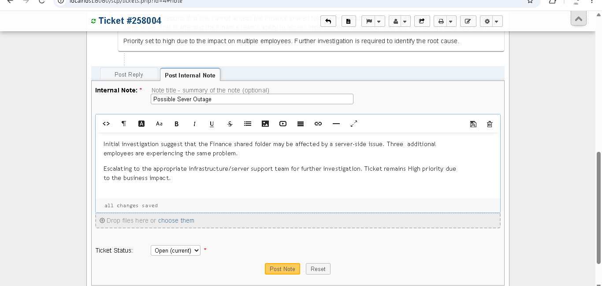

# Lab 02 – Ticket Escalation and Prioritisation

## 1. Project Overview

This lab demonstrates practical IT Help Desk ticket prioritisation and escalation procedures using osTicket.

The focus is on assessing incident severity, understanding business impact, assigning appropriate priority levels, and escalating support tickets when additional technical assistance is required.

**Platform:** osTicket  
**Deployment Environment:** Docker  
**Project:** IT Help Desk & Technical Support Portfolio

## 2. Lab Objectives

- Understand the importance of ticket prioritisation.
- Identify incidents based on severity and business impact.
- Apply appropriate ticket priority levels.
- Understand Level 1 and higher-level support escalation.
- Practise ticket reassignment and escalation procedures.
- Maintain accurate ticket documentation and communication.

## 3. Understanding Ticket Prioritisation

Ticket prioritisation helps IT Support teams determine which incidents require immediate attention.

Factors considered include:

- Number of users affected.
- Business operations impacted.
- Severity of the technical issue.
- Urgency of restoring the affected service.

Common ticket priority levels include:

- Low
- Normal
- High
- Emergency

## 4. Understanding Ticket Escalation

Ticket escalation involves transferring an incident to a higher support level or another appropriate team when additional expertise, access, or authority is required.

Examples include:

- Level 1: Initial troubleshooting and basic technical support.
- Level 2: Advanced troubleshooting and system administration.
- Level 3: Specialist or engineering-level support.

## 5. Practical Implementation

This section documents the practical activities performed in the osTicket environment.

Activities performed:

- Created and reviewed a Finance shared-folder support ticket.
- Assessed the business impact of the incident.
- Assigned High priority because multiple Finance employees were affected.
- Documented the incident and its impact.
- Practised escalation and ticket reassignment.
- Documented support communication and troubleshooting updates.

## 6. Screenshots and Evidence

### 1. Ticket Prioritization

### 2. Business Impact

### 3. Ticket Escalation

### 4. Escalation Communication

## 7. Skills Developed

- Incident prioritisation.
- Ticket escalation procedures.
- Business impact assessment.
- Ticket reassignment and ownership.
- Technical documentation.
- Customer communication.

## 8. Learning Outcomes

This lab demonstrates the importance of prioritising incidents according to urgency and business impact. It also highlights how escalation procedures help ensure that incidents receive the appropriate technical attention and are managed effectively.

## 9. Conclusion

Effective ticket prioritisation and escalation are essential components of IT service management. They help support teams manage workloads, minimise business disruption, maintain accountability, and ensure that technical issues are handled by the appropriate support personnel.
