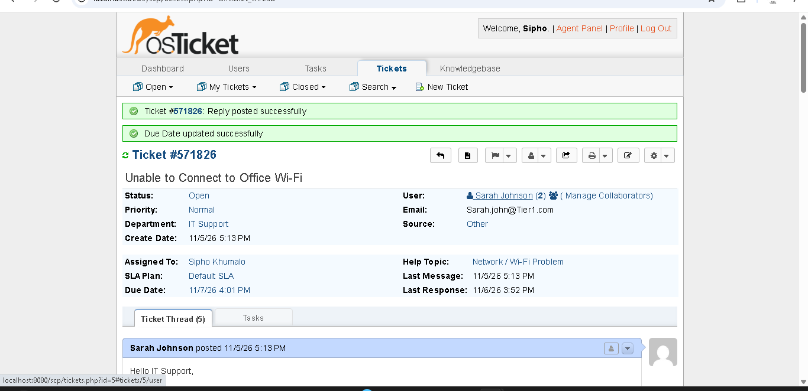

# 04 – Ticket Communication and Customer Support

## 1. Lab Overview

This lab demonstrates customer communication and ticket documentation using osTicket. It focuses on handling customer enquiries, providing support updates, documenting troubleshooting activities, and maintaining professional communication throughout the ticket lifecycle.

## 2. Objectives

- Understand customer communication within a Help Desk environment.
- Send public replies to customers.
- Add internal notes for support agents.
- Document troubleshooting activities.
- Maintain clear and professional ticket communication.
- Communicate ticket resolutions to customers.

## 3. Environment and Tools

- **Ticketing System:** osTicket
- **Environment:** Docker Desktop
- **Platform:** Windows 11
- **Database:** MariaDB
- **Lab Type:** Practical IT Support / Help Desk Simulation

## 4. Public Ticket Replies

Public replies are used by support agents to communicate directly with customers.

They provide a way to acknowledge support requests, request additional information, share troubleshooting instructions, and communicate progress or resolutions.

## 5. Internal Ticket Notes

Internal notes allow support agents to document information that should remain private to the support team.

They can be used to record troubleshooting findings, technical observations, escalation details, and handover instructions.

## 6. Troubleshooting and Customer Updates

Clear documentation helps maintain a record of actions taken to investigate and resolve customer issues.

Providing regular updates keeps customers informed about the progress of their support requests.

## 7. Ticket Resolution Communication

Once an issue has been resolved, the support agent communicates the outcome to the customer and documents the resolution in the ticket history.

Professional communication helps improve customer experience and maintain accurate support records.

## 8. Key Skills Demonstrated

- Customer service and communication.
- Public ticket replies.
- Internal ticket documentation.
- Troubleshooting documentation.
- Customer support updates.
- Ticket lifecycle management.
- osTicket Help Desk operations.

## 9. Screenshots

### Ticket Overview

### Public Reply

### Communication History

### Internal Note

### Resolution Reply

